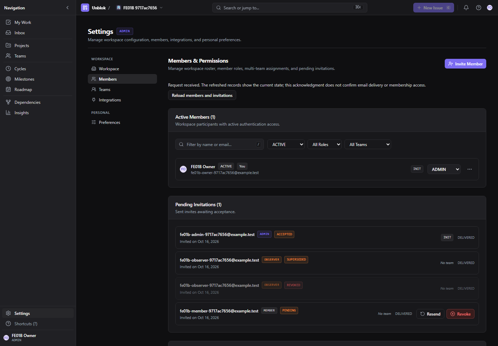
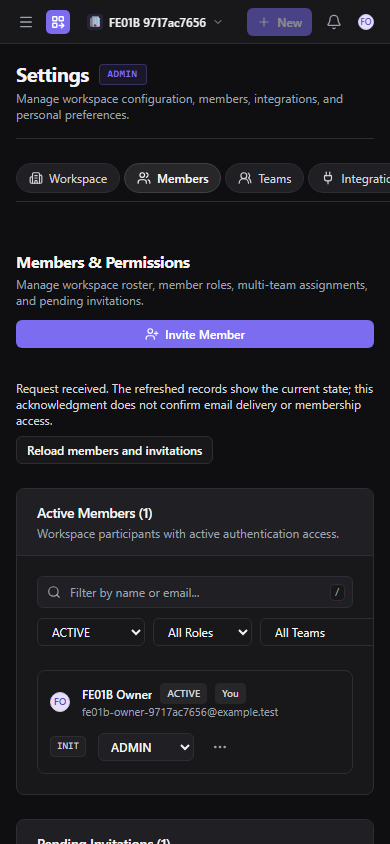
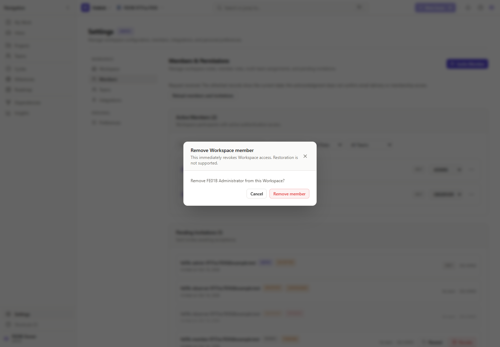

# FE-INTEGRATION-01B — Workspace invitations and membership

Candidate branch: `codex/fe-integration-01b`. Baseline `12403c798b5320490a11c359e0d32f1a442a2ef2` (merged PR #50), re-fetched and unchanged before handoff. The previously created clean branch was fast-forwarded from `57c4a1d…`; no main reset, history rewrite or unrelated work was discarded. Final candidate SHA is recorded in the draft PR and handoff; the checked-in source manifest binds the verified frontend files with LF-normalized SHA-256 values.

**Stop for PM review. No merge, deployment, shared QA change or FE-INTEGRATION-01C work.**

## Result and UX boundary

The actual prototype member settings page, member rows, invitation rows and invitation form now render real administration data through a presentation binding. `/settings/members` and `/workspaces/:workspaceId/members` use the actual SettingsLayout, existing shell and validated selected Workspace. The scoped route retains its explicit Workspace on reload. No prototype data/provider is mounted in live routes.

The demo wrapper continues supplying its original Settings/Project contexts to the same presentation. `AppShellLayout`, `NavigationRail`, `WorkspaceHeader`, `WorkspaceSwitcher`, CSS, themes, navigation destinations/order/icons, NEXUS fixtures and unsupported business pages have no source edits. The new shared invitation metadata card is extracted from the original InvitePage markup, rather than approximated visually.

Approved live-only differences:

- Member removal in a menu built from the existing Popover, with the existing Modal pattern: **“This immediately revokes Workspace access. Restoration is not supported.”** Inactive/removed rows cannot be edited as though they were active.
- Minimal Load more controls for member, invitation, eligible-Team and nested member-Team pages; server search/role/Team/status filters and authoritative totals. Unknown totals are omitted while loading/unavailable, rather than fabricated as zero.
- Server lifecycle badges, observed delivery state, inline loading/error/neutral acknowledgments, stale revision and rate-limit guidance. No successful no-op state or optimistic role/membership grant.
- Privacy-safe real invitation transitions and 24-hour live expiry guidance. Signup remains unauthenticated; verification stays explicit. Demo behavior/copy stays in its original adapter.
- Pending requests use the existing explicit “Start another request / Keep retrying / Use different details” review pattern from Workspace creation. This is an intentional user decision, never an automatic new-key retry or a claim that an earlier request did/did not commit.

## API coverage

Prefix below: `/api/v1/workspaces/:workspaceId/administration`.

| Endpoint | Live binding / evidence |
| --- | --- |
| GET `/memberships` | Bounded keyset pages, server name/email search, role/Team/lifecycle filters; real names, nullable email, roles, lifecycle, active/pending totals and member versions. |
| GET `/memberships/:membershipId/teams` | Explicit continuation of the embedded five-row page; preserves the cursor's **limit=5** binding. Never labels truncated assignments complete. |
| GET `/eligible-teams` | Bounded limit100 continuation; invitation choices are backend-returned eligible Teams, not inferred Workspace ADMIN ownership. |
| GET `/invitations` | Real history, terminal lifecycle, observed QUEUED/DELIVERED/FAILED state, initial Teams and opaque per-invitation revision. |
| POST `/invitations` | ADMIN/MEMBER/OBSERVER, normalized recipient and canonical sorted unique Team plan (maximum20), operation-scoped durable key. Neutral202 only. |
| POST `/invitations/:id/resend`, `/revoke` | Exact quoted row `inv2-…` validator and durable request key. Terminal controls reflect lifecycle; backend remains authoritative for expiry, original issuer and Team eligibility. |
| PATCH `/memberships/:id` | Exact numeric **member** revision, strict role body and durable key. Backend last-admin/Team-owner restrictions remain intact. |
| DELETE `/memberships/:id` | No request body; JSON Content-Type plus CSRF, exact member If-Match and durable key. Soft-removal state comes from the refreshed directory. |
| POST `/api/v1/workspace-invitations/preview` | Read-only CSRF-protected proof POST. Detailed metadata is displayed only when the server returns it to the authenticated, currently verified matching recipient. No isExistingUser or public validity/existence disclosure. |
| POST `/api/v1/workspace-invitations/accept` | Existing MembersApi/InvitationStore and proof-hash acceptance journal retained. Real discovery reconciles access after a neutral acknowledgment; no assumed membership from202. |
| Legacy POST `/api/v1/workspaces/:id/invitations` | A pending pre-01B journal must reconcile at its **original endpoint/body/key** before new administration mutations. It is never silently translated into the new namespace or promoted to ADMIN/Team issuance. |

GET administration invitation detail remains available on the backend but is not called unnecessarily: the approved history surface already receives its complete bounded row projection. No new preview drawer or business API was invented.

## Security and concurrency

AdministrationStore scopes private state to actor ID, session generation, validated selected Workspace, self membership ID/role/status, Workspace lifecycle and current email verification. Reads and writes are aborted/invalidated on authority changes, and every result checks its controller/version before publication. Scope changes remount private UI, including open action menus/forms. A late acknowledgment cannot restore an old scope's notice, rows or authority.

Backend authorization is the decision point for every privileged read/write. Frontend ADMIN/verified/active checks only control available UI and whether a request should be attempted. There are no prototype permissions, no hardcoded successful grants and no Team-owner assumptions. “You” binds to `context.self.membershipId`, independently of global session actor ID.

AdministrationJournal persists only bounded pending request intent: original actor/Workspace/membership, operation/resource, canonical body, original quoted precondition and UUID key. It stores no member/invitation read projections or raw proofs. Unknown network/503/409 outcomes keep the exact original request for an explicit retry; definite400/412/428/429 rejection can clear that rejected intent. No mutation is automatically retried. A malformed/unavailable journal fails closed rather than starting a fresh request.

Existing pre-01B invite journals have a separate reconciliation path via the original MembersApi; new mutations are blocked while one is unresolved. Existing acceptance/creation/Team journals remain intact. Explicit logout/account changes clear pending client scope; Workspace changes hide state and preserve scoped reconciliation intent. The compatibility MembersStore is retained for injected legacy consumers, but is not started as a second live directory store.

Invitation proofs remain in memory. Incoming email fragments are captured and immediately removed with replaceState; they are never copied to route/query continuation, storage, logs or analytics. Manual-code fallback and the existing hashed acceptance receipt journal remain. Same-actor signup/login/verification continuation preserves the proof; logout/account changes and stale preview responses cannot restore private metadata.

No backend, worker, schema, proof cryptography, prior migration, environment file, secret, cookie or CSRF policy changed. All thirteen migration files are unchanged. Every real browser mutation includes the expected same-origin CSRF headers, including bodyless DELETE.

## Confirmed integration corrections found during verification

1. Bodyless DELETE originally omitted JSON Content-Type, which the unchanged session CSRF boundary requires. Fixed in the client, with a header/body regression test and real removal evidence. The backend check was not relaxed.
2. Read-only recipient preview initially competed with login for the exclusive mutation lock. It now bootstraps CSRF with epoch/signal checks and uses a separately fenced read-only POST, without automatic retries. Existing interruption/account-switch tests pass.
3. Entering settings after Team creation could reuse an older eligibility projection. Page entry now revalidates administration; new privileged operations wait for complete current reads. Loading failures do not masquerade as empty business data.
4. Unknown invitation outcomes could close and later reopen the modal. The form now remains open with an explicit same-request retry and closes after acknowledgment. No delivery promise is inferred.
5. Member-Team continuation must use the five-row cursor binding, not the eligible-Team page's100. Corrected and tested. Initial Team ordering is canonicalized **before first send** as well as before persistence/retry, preserving exact request bodies.
6. Terminal409 conflicts retain conservative reconciliation intent; users can explicitly review records and cancel a retry using the existing confirmation pattern. Canceling does not execute a replacement mutation.

## Commands and final results

Bun: `C:\Users\youna\.bun\bin\bun.exe` (1.4.2). Commands run from the repository unless specified.

| Exact command | Result |
| --- | --- |
| `bun run --cwd apps/web test src/features/workspaces/live/Administration.test.ts src/features/workspaces/live/Members.test.tsx src/app/shell/LiveShell.test.tsx` | **70 pass / 0 fail**, three files; includes30 new administration cases. |
| `bun run test:web` | **915 pass / 3 historical NEXUS failures**, 918 tests, 62 files. No assertions/fixtures weakened. Focused tests are included in this total, not added again. |
| `bun run lint:web` | Pass. Repository script runs `tsc --noEmit`; this is the frontend typecheck, not a separate ESLint claim. |
| `bun run typecheck:backend` | Pass; architecture **465 sources / 1,266 resolved edges / zero violations**. |
| `bun run build:web` | Pass; API-isolated production build also passes inside the browser runner. Existing >500KB chunk and Vite config-loader warnings remain. |
| `bun scripts/backend/run-administration-isolated.mjs scripts/backend/workspace-administration.test.ts` | **27 pass / 0 fail**, 1,165 assertions. |
| `bun scripts/backend/run-administration-isolated.mjs scripts/backend/workspace-memberships-invitations.test.ts` | **36 pass / 0 fail**, 1,201 assertions. |
| `bun scripts/backend/run-administration-isolated.mjs scripts/backend/auth-fences.test.ts` | **24 pass / 0 fail**, 134 assertions. |
| `bun scripts/backend/run-administration-isolated.mjs scripts/backend/tenancy.test.ts` | **35 pass / 0 fail**, 135 assertions. |

The four standalone backend runs cover122 tests /2,635 assertions. They preserve permission matrices, cross-tenant fences, expired/revoked/replayed proofs, initial-Team atomicity, last-admin/Team-owner restrictions, migration checksums, v1 compatibility, real delivery and session invalidation. These are separate passing invocations, not a claim that the initial combined command passed.

### Real Chromium and migration13

```powershell
$env:PATH='C:\Users\youna\.bun\bin;'+$env:PATH
$env:PLAYWRIGHT_MODULE='C:\Users\youna\.cache\codex-runtimes\codex-primary-runtime\dependencies\node\node_modules\playwright'
$env:FE_INTEGRATION_EVIDENCE_DIR='<fresh absolute directory outside repository>'
node scripts/frontend/fe-integration-01a.cjs --01b --browser-only --production
```

The existing ownership/sentinel-protected runner is reused. It creates dedicated ephemeral PostgreSQL, Valkey and Mailpit, deploys and counts **13/13 migrations**, starts API and worker from the same source checkout, forces an owned same-origin API proxy with envDir disabled, and builds the real production frontend. `/live` and `/ready` both200. There are no shared ports/volumes, QA environment reads, mail deletions or production migration claims. Both Mailpit sentinels survive; owned services stop afterward.

**Final Chromium run: 15 passing gates / zero failures.** Final browser evidence: [live-browser.json](evidence/FE-INTEGRATION-01B/live-browser.json). Passing gates and HTTP observations are recorded there, including scoped routing, all three invitation roles, Team eligibility/assignment, neutral preview, signup/login/verification continuation, exact same-key/body retry after an intentionally lost committed issuance response, resend/revoke, role changes, confirmed removal, revoked access, real themes/responsiveness, actual Workspace switching/cross-Workspace denial, real server session revocation, same-tab account switching and same-origin CSRF. Unit and backend layers cover delayed responses, membership/account/Workspace changes, pagination, conflicts and terminal security cases not all exercised as separate browser fixtures.

The accelerated multi-account suite explicitly waits at original rate-window boundaries; it does not change admission limits, UI timeouts, transport deadlines or production retry behavior.

### Prototype comparisons

```powershell
$env:FE_INTEGRATION_EVIDENCE_DIR='<another fresh absolute directory outside repository>'
node scripts/frontend/fe-integration-01b-visual.cjs
& 'C:\Users\youna\.cache\codex-runtimes\codex-primary-runtime\dependencies\python\python.exe' scripts/frontend/fe-integration-01b-compare.py $env:FE_INTEGRATION_EVIDENCE_DIR
```

The visual runner builds a read-only Git archive of the exact baseline and the current checkout, with matching installed dependencies and API requests blocked in fresh demo contexts. It does not create worktrees, alter demo fixtures or use the real API. The bundled Python provides Pillow; system Python lacks it and is not a passing comparison command.

- Existing preservation gates: **10/10 baseline and10/10 current**, with matching structural contracts: ten destinations, SVGs, grouping/dimensions, drawers, Create Issue, palette/help, shortcuts, dependency views/filters, Workspace switcher, demo reset/restore/test-user controls and light/dark/mobile behavior.
- Supplemental actual demo member settings and invitation modal checks: **LIGHT and DARK on both builds**, including mobile capture, Escape and focus restoration. The fixture enters through the real demo login as its seeded ADMIN; switching the display test-user alone does not change the demo auth membership. Demo preference Save is activated through its real click handler because the unchanged “NEXUS demo” note overlaps that pointer target. This setup is not claimed as a passing pointer-accessibility test.
- **All six affected member/invite screenshot pairs have identical dimensions and exactly zero differing pixels**: desktop light/dark members, light/dark invitation modal, mobile light/dark members. No tolerance/masking or prototype alteration.
- Baseline and current production CSS bundles are byte-identical; hashes are in the manifest.
- Older reference captures are **not all pixel-identical**:16/31 comparisons differ by3–242 pixels, including repeat captures within a build. Projects, Teams, Dependencies and several overlay captures retain small raster differences. Structural/SVG/style contracts match; shell/business source files are unchanged. Exact bounds/counts are preserved in [pixel-comparison.json](evidence/FE-INTEGRATION-01B/pixel-comparison.json). Renderer/timing variance is a possible explanation, not a fabricated confirmed root cause or a claim of universal pixel equality.

## Failures, skips and limitations retained

- Historical NEXUS failures remain exactly: entity-reference/DAG resolved example; milestone dependency graph population; active blocked-work fan-in/fan-out. Dataset files and assertions are unchanged.
- Initial combined backend run (`workspace-administration`, `workspace-memberships-invitations`, `auth-fences`, `tenancy`) reported **89 pass /11 fail;2,441 assertions**. Reported failures include the6s Prisma setup deadline, a20.46s retired-key/Team-plan case, a10s teardown hook, suspended-recipient eligibility, cancel/epoch/expiry invalidation, retired-key/cursor lifetime, controlled redemption lock ordering, archival-before-acceptance and acceptance-before-logout-all. Their common cause is not established. No test timeout was increased. The four standalone runs above pass; the combined invocation is not reclassified green.
- Every owned browser attempt is retained in [browser-attempt-history.json](evidence/FE-INTEGRATION-01B/browser-attempt-history.json). Early runs include harness selector/invalid-color/full-reload setup mistakes, Docker/Vite startup/navigation failures, an undefined test helper, actual403 DELETE and stale eligibility/modal defects corrected above, real412/409/429 responses, and an observed `ERR_NETWORK_IO_SUSPENDED`. Earlier15/16/19/20 passing runs do not erase failed runs. One later harness expected switching to retain Settings, but the existing switcher correctly navigates to My Work; the test now follows that original navigation. No unsupported failure attribution or silent assertion relaxation.
- Earlier supplemental demo setup attempts failed on both baseline/current (wrong auth role after visual test-user switch, clipped role menu, NEXUS note overlapping Save). Final setup uses the actual demo login and preserves the original product behavior. Those preexisting demo pointer/focus limitations were not repaired by changing the prototype.
- Historical 01A Workspace-navigation flake, combined architecture-test timeout and queue/SIGTERM limitations remain unresolved/documented. The real new scoped member route passes, but that does not prove the old flake's cause resolved.
- No fresh claim for the full backend unit/authentication/password-recovery/Team-management/performance/queue/lifecycle suites; they were not all rerun here. Relevant administration, invitation, auth-fence and tenancy suites were rerun. Browser auto-pagination with more than20 real members, dense Team plans, exhaustive assistive-technology audit and every terminal-proof UI branch are not claimed as executed browser gates; contract/store/backend tests cover those relevant boundaries.
- No new business APIs, application shell redesign, real Projects/Issues/Dependencies/Cycles/Milestones integration, deployment or shared QA readiness certification. Existing real authentication/recovery routes and unsupported pages remain untouched apart from the focused transport extension.

## Screenshot review

Live values are disposable test accounts and backend records, not demo fixtures. Approved live controls/statuses naturally differ from demo data.





Exact demo pairs and raw JSON are alongside these screenshots. Complete raw runs remain outside the repository at `D:\Full_Stack_Apps\Unblok-FE-INTEGRATION-01B-20261016`; checked-in evidence contains no credentials, proof strings or request bodies.

## Changed-file inventory

- `apps/web/src/features/auth/api/authApi.ts`
- `apps/web/src/features/auth/components/InvitationMetadata.tsx`
- `apps/web/src/features/auth/live/LiveRouter.tsx`
- `apps/web/src/features/settings/components/InviteMemberModal.tsx`
- `apps/web/src/features/settings/components/MemberActionMenu.tsx`
- `apps/web/src/features/settings/components/MemberBindings.tsx`
- `apps/web/src/features/settings/components/MemberRow.tsx`
- `apps/web/src/features/settings/components/PendingInvitationRow.tsx`
- `apps/web/src/features/workspaces/live/Administration.test.ts`
- `apps/web/src/features/workspaces/live/AdministrationApi.ts`
- `apps/web/src/features/workspaces/live/AdministrationPage.tsx`
- `apps/web/src/features/workspaces/live/AdministrationStore.ts`
- `apps/web/src/features/workspaces/live/InvitationPage.tsx`
- `apps/web/src/features/workspaces/live/InvitationStore.ts`
- `apps/web/src/features/workspaces/live/MembersContext.tsx`
- `apps/web/src/pages/auth/InvitePage.tsx`
- `apps/web/src/pages/settings/MembersSettingsPage.tsx`
- `apps/web/src/pages/settings/MembersSettingsPageFrame.tsx`
- `scripts/frontend/fe-integration-01a-demo.cjs`
- `scripts/frontend/fe-integration-01a.cjs`
- `scripts/frontend/fe-integration-01b-compare.py`
- `scripts/frontend/fe-integration-01b-demo.cjs`
- `scripts/frontend/fe-integration-01b-journeys.cjs`
- `scripts/frontend/fe-integration-01b-visual.cjs`

- This report; `docs/frontend/evidence/FE-INTEGRATION-01B/` contains the verified source/CSS manifest, final real-browser observations, all browser-attempt summaries, exact demo comparison results and selected screenshots.
- Regenerated historical BE-WS-02 evidence was archived outside the repository under `regression-generated` and restored to its original checked-in contents. No backend implementation, migration, fixture, shell/layout/theme source, dependency or environment file is included in this change.
