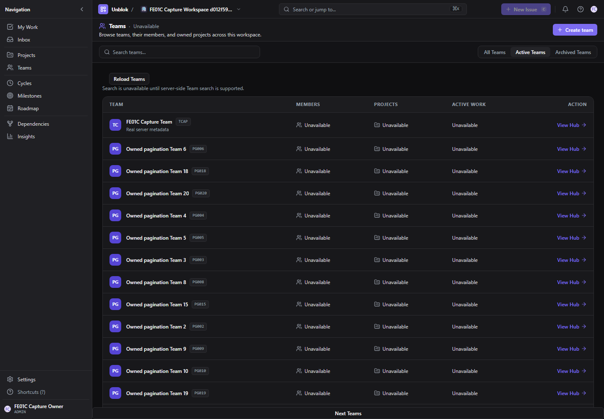
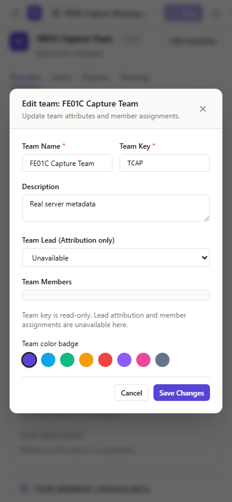
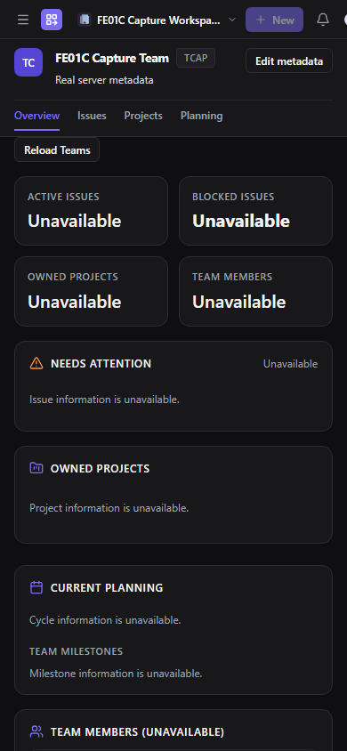

# FE-INTEGRATION-01C — Real Teams in the approved prototype

Status: implemented for draft PM review; not a merge/deployment authorization. Baseline `894488746e134bd3cebb21091edbae2cb12dfb19` (PR #51 merged), branch `codex/fe-integration-01c`. Exact candidate HEAD is recorded in the draft PR/handoff. PM approved the three live-only contract adaptations after the external preflight at `D:\Full_Stack_Apps\Unblok-FE-INTEGRATION-01C-20261016\FE-INTEGRATION-01C-PREFLIGHT.md`.

## PM correction — 2026-10-17

The final membership-pagination correction and fresh verification are recorded at the end of this report. Earlier counts and source manifests describe implementation HEAD `9861aa6aff5ecd768021ed30dedc566f442d5784`; correction evidence is in `evidence/FE-INTEGRATION-01C/correction/`.

## Existing functionality retained versus new integration

The four foundation endpoints, TeamsApi/TeamsStore/TeamsContext, UUID routes, creation and metadata receipts, revision conflicts, CSRF transport and server status pagination already existed. They are reused rather than reimplemented.

This change moves the **actual** prototype directory, hub, creation form, settings metadata form and member-card markup into shared presentation frames. Original demo adapters retain ProjectContext/SettingsContext, selectors, local actions, fixtures and overlay behavior; live adapters never mount those providers. The former separate live page/form markup is replaced with bindings to these frames. All ten sidebar destinations, shell, switcher, themes and styles stay intact.

Live integration includes real directory rows, signed20-row next-page navigation and ACTIVE/ARCHIVED/ALL server filters; creation with prototype key suggestion/palette; direct UUID detail reload; metadata name/description/color editing; fresh server capability checks; owner-authorized20-row membership pages using original member-card presentation and authoritative owner/role/status. No member count is inferred from page length.

Approved live-only differences:

- Team key is read-only after creation. Lead attribution/member assignment controls are noneditable and explicitly unavailable in the metadata form; these fields never enter PATCH. Color uses the existing approved Team palette.
- Search, aggregate totals, Project/Issue/cycle/milestone metrics and unsupported business tabs display honest unavailable values within original layout/patterns. No fabricated zero, global client search or NEXUS business row is used.
- Owner-only membership reads show real display names/owner/role/lifecycle; unauthorized403/404 uses the same neutral unavailable copy. No contact email or owner inference from ADMIN is introduced. Directory has no per-Team membership fan-out.
- Lifecycle/member mutations, ownership transfer and extra management UX remain deferred to01D. Backend, schema, migrations, fixtures and environment files are untouched.

## API coverage

Prefix `/api/v1/workspaces/:workspaceId/teams`.

| Operation | Contract and live binding |
| --- | --- |
| GET collection | limit20; ACTIVE/ARCHIVED/ALL; signed after cursor. One bounded page, not fake aggregate counts or fetch-all. |
| POST collection | Strict name/key/description/approved color; original UUID Idempotency-Key and CSRF;201 actual detail. Confirmed response navigates to authoritative UUID. |
| GET `/:teamId` | Schema/Workspace/Team identity validation; direct reload; fresh updateMetadata capability before editor opens. |
| PATCH `/:teamId` | Name/description/color only. Original `If-Match: "team-<version>"` and key/body survive uncertainty;200 validated detail refresh. |
| GET `/:teamId/memberships` | New read binding to existing owner-only endpoint, limit20/statusALL/opaque after. No mutation, contact discovery, total or role-only ownership assumption. |

Existing401/session fencing,403/404 privacy,409 uncertainty/stale cursors,412 explicit conflict,428 original precondition,429 Retry-After,503/network uncertainty behavior remains authoritative. No automatic mutation retry, optimistic successful no-op or refreshed-precondition substitution. A stale412 draft remains mounted and requires the existing explicit review/use-refreshed-version choice, then a separate user submit with a new key.

## Recovery and private-state policy

TeamJournal now retains all unrelated actor/Workspace/membership/operation/Team scopes. It strictly validates canonical bodies, UUIDs, original strong preconditions, field allowlists, duplicate scopes and the eight-entry/128KiB bounds. Conflicting writes/removals fail closed. The sole mutable annotation is a monotonic conflict flag on the exact same request; it cannot replace the original payload/key/validator. There is no bulk clear API.

Logout, expiry, account/Workspace/member-identity/Team/lifecycle changes abort/fence old completions and clear visible private projections; they do not erase uncertain receipt history. Restoration requires the original current authorized membership identity. Already-issued server requests are never claimed canceled by transport abortion. Confirmed current-scope success or existing definitive400 rejection removes only its exact intent. Explicit412 resolution acknowledges a definite stale request before a new explicit submit; other unknown outcomes retain their original request.

Legacy Team journal rows without membership identity are preserved byte-for-byte and **block mutation**, not silently assigned to the current membership, migrated, deleted or sent with a fresh key. Operator/human reconciliation of such a legacy pending request remains a limitation; do not clear storage to bypass it without reviewing the original request. Tab closure/manual browser clearing can still lose tab-scoped evidence. Retained journal metadata may contain Team names/descriptions; sessionStorage is not confidentiality from someone inspecting the browser. No password, proof, cookie or CSRF token is stored.

New membership reads are canceled and projection-cleared before detail refresh, on every authority change and on route changes. A denied owner-directory request does not remove otherwise-authorized Team metadata or invalidate its Workspace. Every actual backend read/mutation reauthorizes; cached visual state grants no permission.

## Verification results

```powershell
$env:GOMAXPROCS='2'
$env:RAYON_NUM_THREADS='2'
bun run --cwd apps/web test src/features/teams/live/Teams.test.tsx src/features/teams/teams.test.tsx src/features/settings/domain/teamAdministration.test.ts --maxWorkers=2
bun run lint:web
bun run build:web
bun run --cwd apps/web test --maxWorkers=2
$env:PLAYWRIGHT_MODULE='C:\Users\youna\.cache\codex-runtimes\codex-primary-runtime\dependencies\node\node_modules\playwright'
$env:FE_INTEGRATION_EVIDENCE_DIR='<new absolute directory outside repository>'
node scripts/frontend/fe-integration-01a.cjs --01c --browser-only --production
# Fresh services for settled final-source screenshots:
node scripts/frontend/fe-integration-01a.cjs --01c --browser-only --production --capture-only
# Separate owned services and serial backend invocations:
node scripts/frontend/fe-integration-01a.cjs --01c --backend-only --production
# Separate visual baseline/current archives, no worktree or backend access:
$env:FE_VISUAL_BASE_SHA='894488746e134bd3cebb21091edbae2cb12dfb19'
$env:FE_DEMO_TEAMS='true'
# Omit TEAMS_ONLY to run the broader existing demo checks too.
$env:FE_DEMO_TEAMS_ONLY='true'
node scripts/frontend/fe-integration-01b-visual.cjs
& '<bundled Python with Pillow>' scripts/frontend/fe-integration-01c-compare.py '<visual evidence directory>'
```

- Focused frontend:84/84 pass (53 live Team cases,31 existing prototype/domain cases).28 additional cases cover two actors, multiple Workspaces/membership identities, cap/malformed/legacy journals, exact requests, conflict annotations, owner-only page/denial and delayed membership responses.
- Three old expectations of global journal deletion were updated to explicit retention checks to implement the approved policy. Other existing security/prototype/fixture assertions remain; no NEXUS assertions or timeouts were weakened.
- TypeScript (`lint:web` is `tsc --noEmit`, not separate ESLint) and build: pass. Existing Vite native-config/large-chunk warnings remain.
- Complete frontend bounded-worker run:960 pass/3 historical NEXUS failures,963 tests/62 files. Final-source run completed on2026-10-17:960 pass/3 unchanged historical failures, no worker errors.
- Backend final serial run: Team foundation33/33 (773 assertions), Team management35/35 (1,031), tenancy35/35 (135), auth fences24/24 (134): **127 pass/0 fail;2,073 assertions**. Source/matching API/worker `/live` and `/ready`200;13 applied migrations in the owned disposable database; both Mailpit sentinels preserved. The earlier exit0 run had empty direct Windows file-descriptor logs; final pipe-captured logs and command results establish these counts.
- Team prototype capture interactions:4 viewport/theme combinations per build, directory/hub/create/edit; all8 scene groups pass. Exact primary raster comparison:15/16 pairs identical; desktop dark creation differs by1 pixel. CSS SHA-256 is identical (`219e9d0180c254fe27c0a48a6cac9ca6fc2ea9e6f72adba24d4be5c37d4be51a`). The zero-tolerance comparison **fails** on that1 pixel; it is not relabeled green. Repeat captures also differ within each build (up to28 pixels in these captures; cross-build repeated captures up to50). No layout or CSS difference was observed; exact raster causation remains unresolved. Broader demo suite performed10 checks per baseline/current (navigation/icons/dimensions/drawers/keyboard/reset/restore/themes), while its supplemental Team setup failed; those20 successful checks remain partial evidence, not a green whole run.
- Full live Chromium: **13/13 gates pass**, including two actors/two Workspaces, committed-response loss, original keys/bodies/If-Match, direct reload, ownership/privacy denial, stale revision review, true20+2 page traversal/status filtering/keyboard activation, invitation-derived Team access, Workspace switching, real membership removal and session revocation. Both sentinels preserved, zero runtime errors, CSRF/Origin checks on every real mutation.
- Final settled-data capture run: **1/1 capture gate pass,16 screenshots**, actual rendered server rows/owner details,1440/390 light/dark directory/hub/create/edit; final read-only key and unavailable Lead label assertions pass. The full13-gate run preceded only the final live Lead-label clarification/import cleanup; the dedicated capture and full frontend/typecheck/build runs verify final source. No security/transport behavior changed after that full journey. Membership replacement and delayed completions are fixture-driven store tests, not claimed as real database replacement in Chromium.
- Backend generated query/benchmark evidence from both reruns is archived outside the repository and its five original tracked artifacts restored. No backend implementation/evidence replacement is included. All owned test containers were stopped; shared services remain untouched.

## Failed attempts and historical limitations retained

- Initial overlapping verification exhausted Windows commit memory: native TypeScript VirtualAlloc errno1455, one Vite memory-allocation failure and two frontend worker exits134. The incomplete full run reported914 pass/3 historical failures plus2 worker errors; it is not relabeled a complete pass. Serial bounded concurrency subsequently completed without those worker errors. No test assertion/deadline changed.
- Initial visual run completed core baseline/current shell checks but did not produce a usable final artifact; failed one-byte screenshot artifacts remain outside the repository. Later visual attempts are documented below.
- Browser attempt1 stopped at verification button visibility/click during overlapping resource failures; exact cause unproven. No product fix is attributed to it. Attempt2 passed3 gates then hit actual429 Workspace read admission46-second guidance. Attempt3 passed6 gates then the harness reloaded unscoped Preferences and reached the existing Workspace-selection boundary; final harness uses actual Settings navigation. All attempts remain preserved.
- Browser attempt4 verified real seeded20-row first-page pagination, but the assertion checked the next page during the deliberate loading/cleared-row state (0 instead of2). The harness now waits for the first returned next-page row; count2 and disjoint-page assertions are unchanged.
- Visual attempts2–4 exposed baseline/current harness assumptions: demo login returnTo handling, full reload resetting the prototype test-user projection, and the separate mobile Settings navigation label. Tests now use actual SPA navigation and the existing responsive controls. Attempt5 had a baseline screenshot-protocol failure; attempt6 captured all surfaces but exact comparison differed858/24 pixels in light creation, primarily a name-input focus ring. Attempt7 explicitly focuses the same field after existing Modal initialization and records repeat captures; final exact result is the1-pixel failure above. No prototype changes, tolerance or masking was used.
- Explicit60-second pauses separate accelerated browser read windows. Creation rate limits remain5/hour per actor; directory pagination uses clearly owned disposable SQL fixture Teams, not raised/reset production budgets. Actual creation/metadata/lost-response journeys still use real HTTP/server effects. Fixtures create no shared QA or NEXUS records.
- Historical NEXUS resolved-issue reference absence, empty milestone graph and graph fan-out3>2 remain separate. Historical Workspace-navigation flake, combined architecture deadline, queue/SIGTERM, performance/deployment and prior backend limitations are not resolved by this frontend change.
- No01D implementation, deployment, shared QA readiness certification, ownership recovery or missing business API is claimed.

## Evidence and changed-file inventory

See [complete file inventory](evidence/FE-INTEGRATION-01C/changed-files.json), [verified source/tests](evidence/FE-INTEGRATION-01C/verified-source.json), [browser13 gates](evidence/FE-INTEGRATION-01C/live-browser.json), [final rendered captures](evidence/FE-INTEGRATION-01C/rendered-captures.json), [backend counts](evidence/FE-INTEGRATION-01C/backend-counts.json), [exact pixels/CSS](evidence/FE-INTEGRATION-01C/team-pixel-comparison.json), [within-build repeats](evidence/FE-INTEGRATION-01C/repeat-diagnostics.json), and [earlier failed attempts](evidence/FE-INTEGRATION-01C/attempt-history.json). Raw attempts are preserved under `D:\Full_Stack_Apps\Unblok-FE-INTEGRATION-01C-20261016`. Secrets/raw proofs are excluded from checked-in evidence.

Stop at PM review. Draft PR only; no merge or deployment.

## Selected final live screenshots

These are owned disposable records, not NEXUS or shared QA data. Demo baseline/current comparisons are in the adjacent evidence/demo directory.





## Exact source and verification-script files

- `apps/web/src/features/settings/components/EditTeamModal.tsx`
- `apps/web/src/features/settings/components/EditTeamModalFrame.tsx`
- `apps/web/src/features/teams/components/CreateTeamModal.tsx`
- `apps/web/src/features/teams/components/CreateTeamModalFrame.tsx`
- `apps/web/src/features/teams/live/TeamDialog.tsx`
- `apps/web/src/features/teams/live/TeamJournal.ts`
- `apps/web/src/features/teams/live/Teams.test.tsx`
- `apps/web/src/features/teams/live/TeamsApi.ts`
- `apps/web/src/features/teams/live/TeamsPages.tsx`
- `apps/web/src/features/teams/live/TeamsStore.ts`
- `apps/web/src/pages/teams/TeamHubPage.tsx`
- `apps/web/src/pages/teams/TeamHubPageFrame.tsx`
- `apps/web/src/pages/teams/TeamsDirectoryPage.tsx`
- `apps/web/src/pages/teams/TeamsDirectoryPageFrame.tsx`
- `scripts/frontend/fe-integration-01a-demo.cjs`
- `scripts/frontend/fe-integration-01a.cjs`
- `scripts/frontend/fe-integration-01b-visual.cjs`
- `scripts/frontend/fe-integration-01c-compare.py`
- `scripts/frontend/fe-integration-01c-demo.cjs`
- `scripts/frontend/fe-integration-01c-journeys.cjs`

The complete inventory JSON includes this report and every individual evidence artifact.


## Final PM correction: accumulating Team membership pages

Review: https://github.com/YounasKhan2/Unblok/pull/52#issuecomment-6224773875. Parent/reviewed HEAD: `9861aa6aff5ecd768021ed30dedc566f442d5784`. The correction commit SHA is recorded in PR #52 after commit/push.

**Confirmed root cause:** `loadMembers(true)` set `members=null` and then published only the next response, replacing the first 20 records. It now snapshots the validated prior page, issues one bounded request, checks the original session/actor/Workspace/membership generation and Team plus aborted-request fence, and appends only a valid response in that context. Fresh reload replaces records from page one and clears cursor history. Route/authority changes abort the read, clear projections and consumed cursor history; their eventual completions cannot append. The membership endpoint has a fixed ALL filter in this milestone; directory filtering continues its separate fresh server-page behavior.

Duplicate membership IDs within a page or overlapping earlier pages, malformed/overlarge DTOs, empty nonterminal pages, repeated/current/previously-consumed cursors are rejected. Previously validated rows remain after an invalid continuation/transport failure, continuation stops, and the existing inline unavailable feedback appears; Reload Teams explicitly reloads from page one. Authorization/session denial (401/403/404) or stale-context 409 clears earlier pages instead of presenting them as current. No automatic retry, deduplication, silent overwrite, inferred aggregate total or backend change is introduced. Existing member loading presentation and Next members control are retained. TeamJournal and its recovery semantics are untouched.

### Correction changed source files

- `apps/web/src/features/teams/live/TeamsStore.ts`: accumulation, duplicate/cursor checks and scope-safe invalidation.
- `apps/web/src/features/teams/live/TeamsApi.ts`: reject empty nonterminal bounded member responses.
- `apps/web/src/features/teams/live/TeamsPages.tsx`: reuse existing inline error text alongside retained validated rows.
- `apps/web/src/features/teams/live/Teams.test.tsx`: 17 new cases; the earlier bounded-page fixture now returns a genuinely distinct second member rather than repeating the first ID.
- `scripts/frontend/fe-integration-01a.cjs`: isolated, label-checked owner-bound 21-member fixture callback.
- `scripts/frontend/fe-integration-01c-journeys.cjs`: targeted --members-only real API/Chromium path.

Report and correction evidence/logs/screenshots are the only other changes. No CSS, shared presentation frame, demo adapter, shell, fixture, journal, backend, schema or migration edits.

### Fresh correction checks

Commands (repository root, Bun on PATH; GOMAXPROCS=2 and RAYON_NUM_THREADS=2):

```powershell
bun run --cwd apps/web test src/features/teams/live/Teams.test.tsx src/features/teams/teams.test.tsx src/features/settings/domain/teamAdministration.test.ts --maxWorkers=2
bun run lint:web
bun run build:web
$env:PLAYWRIGHT_MODULE='C:\Users\youna\.cache\codex-runtimes\codex-primary-runtime\dependencies\node\node_modules\playwright'
$env:FE_INTEGRATION_EVIDENCE_DIR='D:\Full_Stack_Apps\Unblok-FE-INTEGRATION-01C-CORRECTION-20261017\browser-2'
node scripts/frontend/fe-integration-01a.cjs --01c --browser-only --production --members-only
```

- **101/101 focused tests pass, 3/3 files**, including 20+2 ordered accumulation, no extra request after exhaustion, duplicate concurrent-click suppression, fresh reload, six invalid-continuation cases, multi-step cursor cycles, 401/403/404/409 clearing, and delayed next-page responses across actor/Workspace/membership/Team/logout changes.
- **Typecheck passes** (`lint:web` is the repository TypeScript check); **production build passes**. Existing native-config/chunk-size warnings remain.
- **1/1 targeted Chromium gate passes**, production bundle with real API/worker, owned disposable PostgreSQL/Valkey/Mailpit, **13/13 migrations** in that disposable database. Signup/login/verification used real UI; Workspace/Team setup used real same-origin CSRF APIs, then 21 additional owned fixture memberships were inserted only in the labeled disposable DB after owner checks. The real owner directory returned **20 and 2** rows through exactly **two** limit=20/status=ALL HTTP200 requests (second with the backend-issued cursor). Browser asserted **22 unique displayed member names**, every prior 20 retained, all expected fixture names and the owner present. No aggregate count was inferred/displayed. Both sentinel messages survive, zero mail deletions, zero runtime errors. Shared QA unchanged.
- Evidence: [browser JSON](evidence/FE-INTEGRATION-01C/correction/browser-members.json), [first 20 screenshot](evidence/FE-INTEGRATION-01C/correction/members-first-20.png), [after second page screenshot](evidence/FE-INTEGRATION-01C/correction/members-all-22.png), [source hashes/results](evidence/FE-INTEGRATION-01C/correction/verification.json). Screenshots capture the current viewport of the shell's scrollable member area; the 22-name assertion checks the complete rendered DOM.
- **One failed browser setup is retained**, not counted as passing: browser-1 clicked Create workspace after email verification and timed out waiting for Workspace name while still on Your account. No runtime errors; exact cause remains unresolved, consistent with the historical navigation flake. Evidence/screenshot preserved in correction/. Targeted membership setup now uses the existing real Workspace API instead; this does not claim the UI navigation defect is fixed. No timeout increased, counter reset or assertion weakened.
- Strict prototype pixel comparison **not rerun** for this data-only correction. Prior **15/16 exact; one pixel differs** remains a strict failed visual result. Current compiled CSS hash remains `219e9d0180c254fe27c0a48a6cac9ca6fc2ea9e6f72adba24d4be5c37d4be51a`. No CSS change/tolerance weakening.
- Broad backend/full-frontend/13-gate browser suites were **not rerun** in this focused correction; their earlier results above are historical evidence, not fresh results for this commit. Three historical NEXUS failures, architecture timeout, queue/SIGTERM issues and navigation flake remain documented and unresolved. No claim of shared QA migration/application readiness is made.

Draft PR #52 remains for PM re-review; no merge/deploy/01D work.
